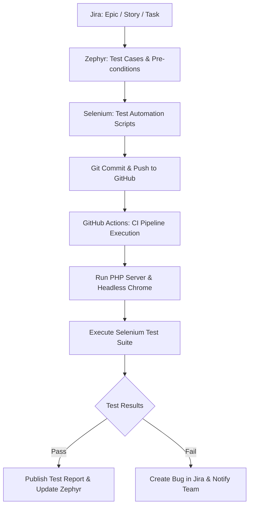

# QA Engineering & Automation Roadmap: Jira, Zephyr, Selenium & CI/CD

Dokumen ini disusun sebagai panduan menyeluruh (*Blueprint*) untuk mengimplementasikan **Quality Assurance (QA) Lifecycle**, **Test Management (Jira + Zephyr)**, **Automated UI/E2E Testing (Selenium)**, dan **Continuous Integration / Continuous Deployment (CI/CD)** pada proyek **Custom Web Profile & POS**.

> **Jira Integration**: Proyek ini terhubung langsung ke Jira Project `KAN` (`rphannfvs.atlassian.net`).

---

## 1. Arsitektur & Alur Kerja (QA Workflow)



---

## 2. Rencana Implementasi Jira Software & Zephyr

### A. Struktur Hierarki Jira
1. **Epic 1**: `EPIC-PUB` - Web Profile & Digital Menu Experience
2. **Epic 2**: `EPIC-POS` - Point of Sale (POS) Order & Checkout Engine
3. **Epic 3**: `EPIC-ADM` - Backoffice Administration & Management
4. **Epic 4**: `EPIC-PAY` - Midtrans QRIS & Cash Payment Integration

### B. Matriks Test Case Zephyr (Zephyr Scale / Squad)

| Test Case Key | Nama Test Case | Pre-Condition | Prioritas | Tipe Eksekusi |
| :--- | :--- | :--- | :--- | :--- |
| **TC-PUB-001** | Navigasi Halaman Utama & Akses Jam Buka | Web server aktif | Normal | Automated (Selenium) |
| **TC-PUB-002** | Buka Modal Menu & Carousel Slide Multi-Foto | Produk memiliki >1 foto | High | Automated (Selenium) |
| **TC-PUB-003** | Menu Tanpa Foto / 1 Foto (Tidak ada tombol slide) | Produk hanya memiliki 1 foto | Medium | Automated (Selenium) |
| **TC-POS-001** | Kasir: Tambah Menu ke Keranjang & Hitung Total | Akun kasir siap, menu tersedia | Critical | Automated (Selenium) |
| **TC-POS-002** | Kasir: Checkout Pembayaran Tunai & Cetak Struk | Minimal 1 item di cart | Critical | Automated (Selenium) |
| **TC-POS-003** | Kasir: Pembayaran QRIS Midtrans (Muncul Snap Popup) | Server key terkonfigurasi | High | Automated / Semi-auto |
| **TC-ADM-001** | Admin: Autentikasi Login Backoffice Sukses | Kredensial valid | Critical | Automated (Selenium) |
| **TC-ADM-002** | Admin: Login Gagal dengan Kredensial Salah | Username/Password invalid | High | Automated (Selenium) |
| **TC-ADM-003** | Admin: Tambah Menu Baru dengan Multi-Upload Foto | Form menu terisi lengkap | High | Automated (Selenium) |
| **TC-ADM-004** | Admin: Filter & Export Laporan Penjualan (CSV) | Terdapat data transaksi | Medium | Automated (Selenium) |

---

## 3. Struktur Modul Automation Selenium

Rekomendasi stack otomasi pengujian menggunakan **Python + Pytest + Selenium WebDriver** atau **Node.js (Jest) + Selenium**.

### Rekomendasi Struktur Folder (Page Object Model - POM):
```text
tests/
├── conftest.py                   # Setup WebDriver, headless chrome options & base URL
├── requirements.txt              # selenium, pytest, pytest-html, webdriver-manager
├── pages/                        # Page Object Model (POM)
│   ├── base_page.py              # Wrapper click, wait, input, scroll
│   ├── public_page.py            # Selector & aksi beranda dan modal menu
│   ├── pos_page.py               # Selector & aksi kasir POS & checkout
│   └── admin_page.py             # Selector & aksi login dan backoffice
├── suites/                       # Skenario pengujian
│   ├── test_public_menu.py       # Pengujian halaman publik & slider foto
│   ├── test_pos_checkout.py      # Pengujian alur kasir
│   └── test_admin_flow.py        # Pengujian login & kelola produk
└── reports/                      # Output laporan HTML & Screenshot kegagalan
```

---

## 4. Rencana Otomasi CI/CD (GitHub Actions)

Workflow GitHub Actions (`.github/workflows/qa-automation.yml`) akan menjalankan:
1. **Trigger**: Setiap kali ada `push` atau `pull_request` ke branch `main`.
2. **Environment Setup**:
   - PHP 8.2 & SQLite.
   - Google Chrome & ChromeDriver headless.
   - Python test runtime.
3. **Local Dev Server**: Menjalankan server PHP lokal (`php -S 127.0.0.1:8008 -t public`).
4. **Execution**: Menjalankan suite Selenium.
5. **Artifacts**: Mengunggah laporan pengujian HTML dan screenshot jika gagal.
